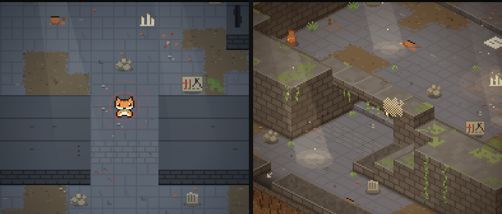
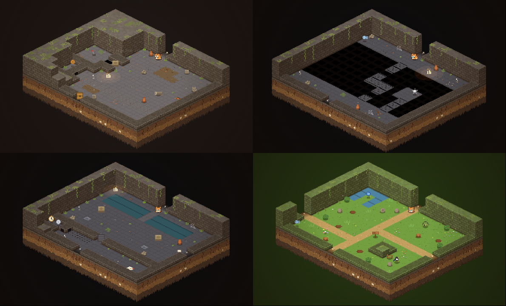

# Isometric prototype: validation pass

This pass asks whether isometric rendering improves UNEARTH enough to justify
what it costs to build and maintain. No rooms were converted, nothing was
merged, and production was not touched. Every number below was measured in
this pass. The method is noted under each result.

> **No real iPhone was available.** No device or computer was connected to
> this session. Every result comes from Chromium emulating iPhone viewports,
> with CPU throttling as a stand-in for slower phones. Real iOS Safari
> behaviour (WebKit canvas compositing, memory limits, touch latency) is
> **unverified**.

## Recommendation

**Keep the original top-down presentation for gameplay.** Do not convert the
game.

Iso makes UNEARTH look richer. But the game's core loop is reading subtle
ground tells (soft earth, slightly-wrong bricks, dart holes) and steering
CK one tile at a time, and the measurements show iso makes exactly that
harder. Converting would also take roughly twice my earlier estimate, and
every future mechanic would need two renderings.

Two worthwhile pieces carry over cheaply:

- **Integer pixel scaling in the flat view.** On every phone measured, the
  current view scales art by a fractional factor, so pixels come out uneven.
  This is about 1 day of work and needs no change of perspective.
- **Iso as presentation only, if wanted later.** A title-screen diorama, or
  an ending tableau of the Hollow, where nothing has to be read or steered.

If you want to keep iso open as a possibility, the cheapest next step is not
building more. It is a real-iPhone check plus a 3–5 person playtest of the
diagonal controls in the existing preview.

## 1. Technical validation

### The default game is unaffected (measured)

| Check | Result |
|---|---|
| Unit and E2E suites on the branch | 141/141 unit and 10/10 E2E tests pass (E2E runs the normal game) |
| Pixel diff, `main` vs branch, same seeded randomness and frozen clock | Home room identical (0 px). Title and play frames differ at the same level as `main` against itself (animation noise: 342–767 px between two runs of `main`) |
| Network without `?iso` | Only `index.js` and `index.css` are requested. The iso chunk is never downloaded |
| Saved data without `?iso` | Same keys as `main` (`unearth.save.v2`, `unearth.playtime.v2`) |
| Main bundle size | +1.28 kB gzipped (129.19 → 130.47 kB): the flag, the d-pad arrows and the import hook |

### Frame stability (emulated iPhone 13 viewport, scripted run: walking, a dig, the dart strip)

| | 4× CPU throttle | 6× CPU throttle |
|---|---|---|
| Flat | 60 fps, p99 16.8 ms, 1 frame > 33 ms | 59 fps, p99 16.8 ms, 4 frames > 33 ms |
| Iso | 59 fps, p99 16.8 ms, 1 frame > 33 ms | 57 fps, **p99 33.3 ms, 14 frames > 33 ms, worst 150 ms** |
| JS heap | 10 MB | 18 MB (baked wall pieces and floor) |

Steady state matches flat. Iso has **less headroom**, though: the floor
rebake after a dig takes ~47 ms at 4×, and the first entry into a room
~220 ms. On older iPhones that will show as hitches. It also matters for
the Crumbling Span, where tiles collapse mid-run and each collapse
currently triggers a full floor rebake.

### Scaling and pixel clarity (5 emulated devices)

| Device | Flat: device px per art px | Iso: device px per art px | CK on screen (flat / iso) |
|---|---|---|---|
| iPhone SE | 3.64 | **4** | 29 / 32 css px |
| iPhone 13 | 6.65 | **6** | 35 / 32 |
| iPhone 15 Pro Max | 7.33 | **6** | 39 / 32 |
| iPad mini | 8.73 | **6** | 70 / 48 |
| iPhone 13 landscape | 12.78 | **9** | 68 / 48 |

- Iso always lands on whole device pixels. Flat never does, so its art
  pixels alternate between two sizes. **That fix doesn't need iso.**
- On iPhone SE, iso shows only 160 × 148 art px of the world: about five
  diamonds across.
- Landscape gives the play area 70 css px of height **in both modes**. That
  is an existing layout issue, not an iso one.

### Touch

- **Hit areas:** sampled every 2 px over the pad. Each rotated button keeps
  the same reachable area as before (~2,150 vs ~2,070 css px²).
- **Placement:** all four buttons are fully on screen on SE, 13 and 15 Pro
  Max. Only the pad's empty corners extend past the edge.
- **Code path:** input handling is unchanged, so input-to-move latency is
  unchanged.
- **Not measured:** real-device touch latency and thumb comfort.

## 2. Gameplay and readability

The method: a harness renders every occluder in a room (walls, the gateway,
upright props), then measures (a) how much of each important tile is
covered, and (b) how much of CK is hidden on each tile CK can stand on.
The flat view covers nothing, so every number here is a cost iso adds.

| Entry Hall | As shipped in the PR | Without the decorative gateway |
|---|---|---|
| Tiles where CK is > 25% hidden | **10** (8 of them > 50%, 3 of them 96–100%) | **0** |
| Buried finds > 25% covered | 1 of 5 (the ring at 4,8: **88%**) | 1 of 5 (38%) |
| Soft-earth tiles > 25% covered | 9 of 24 | 9 of 24 (≤ 38%) |
| Trigger bricks > 25% covered | 1 of 3 (38%) | 1 of 3 |
| Exits > 25% covered | 2 of 2 (36%) | 2 of 2 |

What this shows:

- **The gateway (pillars and lintel) I added was a mistake.** It causes all
  of the heavy CK occlusion and nearly hides a buried find. It should go.
- **The automatic cutaway generalizes.** Across all 15 rooms (run unchanged,
  as a throwaway diagnostic), CK is never more than 25% hidden.
- **Its cost is clipped tile edges.** The low cut walls cover up to 38% of
  tiles just behind them, and upright props cover up to 65%. Exits sit on
  room edges, so they are almost always partly covered (all 15 rooms).
- **The trap's teaching moment loses clarity.** Same spot, same frame size,
  flat on the left and iso on the right: the trigger strip and dart holes
  read at a glance in flat, and barely register in iso.

  

- **"Which tile am I facing?" is less obvious.** Dig, Hop and Paw act on the
  faced tile. In iso that tile is diagonal, and the only cue is CK's
  three-quarter sprite. The front-left and front-right poses are mirror
  images of a 16-pixel cat.
- **Diagonal controls are not validated.** The rotated pad is internally
  consistent, but every move is now a diagonal, the keyboard's Up goes
  up-right, and corridors run across the screen at 30°. Whether that feels
  natural can only be answered by playtesting, which hasn't happened. Mixing
  views makes it worse: the d-pad changes meaning at room boundaries.

## 3. Visual assessment

- **What iso genuinely adds:** depth, a sense of place, the diorama block
  with its earth strata (on theme for a digging game), mood from light
  shafts and a warm grade, and crisp whole pixels.
- **Inconsistent:**
  - Front-on props stood upright on an isometric floor. Signs, the frieze
    and the fallen column read in the wrong perspective.
  - Doors, levers and blocks fall back to half-scale flat art.
  - The HUD's serif room title next to the pixel-font banner.
- **Busy:**
  - Moss on every wall cap.
  - Floor scatter that reads as noise once resampled.
  - Light pools stacked on dark soft-earth patches, so the signal the player
    hunts for now competes with decoration.
- **The improvement that matters most for play:** remove the gateway, and
  draw exit chevrons above the wall layer. Decorative polish beyond that
  wouldn't change the verdict.

## 4. Architecture and expansion

The same renderer, unchanged, run over four rooms with different mechanics.
This is a diagnostic only; none of these rooms were converted.

| Room | What breaks |
|---|---|
| Puzzle chamber (temple2) | The pushable block, lever and pressure door use flat fallback art at half scale. Pits are drawn as flat dark squares, with no depth |
| The Chasm | The drop is a flat black plane, and the crumbling span has no sense of height. A full floor rebake on every collapsing stone risks hitches mid-run |
| Crypt (dark room) | **Darkness isn't implemented**: the room is fully lit, which removes the Sunstone, Mew and Hush mechanics. **Spikes aren't drawn**, so a timing hazard is invisible. This is gameplay-breaking |
| Meadow (outdoors) | Hedges and trees become brick masonry, because walls use one material per renderer. Every region needs its own wall art |

None of these are dead ends, but each is new rendering work rather than
reuse. The pattern is clear: **each mechanic needs its own iso
treatment**. The one room built so far was the easiest kind: lit, with
static walls and one trap type.

### Re-estimate

The earlier estimate assumed ~23 rooms; the game has **15**. Even so, the
estimate was too low, because it under-counted mechanic coverage, art and
validation.

| Work | Days |
|---|---|
| Wall, cap and ground materials per region, including hedges, trees and the interiors of home | 4–6 |
| Darkness, Sunstone light, echo and the Hush in iso | 3–4 |
| Pits and the chasm with real depth, water, the crumble span with partial rebakes | 3–4 |
| Spikes, falling rocks and the boulder in iso | 2–3 |
| Doors, levers, blocks; 3/4 sprites for Dad, Shellby, Magpie, Mortimer and Pip; CK's dig, hop and hold frames | 5–7 |
| Iso-perspective redraws for ~15–20 props that read wrong upright | 3–5 |
| Per room: elevation, readability harness pass, fixes (15 rooms) | 6–8 |
| Title scene and journal map to match | 2–3 |
| Controls: playtest, plus likely a tap-to-walk or swipe option | 3–5 |
| Real-device QA on several iPhones, perf work, iso E2E and readability CI | 4–6 |
| **Full conversion** | **≈ 35–51 days** (was 19–24) |

## 5. Options compared

| | Full isometric | Hybrid (a few set-piece rooms in iso) | Keep the original |
|---|---|---|---|
| **Benefits** | Strongest sense of place; one consistent look; whole-pixel art everywhere | Depth where it matters most (the Entry Hall, the Hollow); less art | Best readability for a game about reading the ground; proven controls; zero risk |
| **Drawbacks** | Measured readability costs on every room; diagonal controls; ~2× the work I first estimated | **Controls change meaning between rooms**; two looks; every future mechanic drawn twice | Less spectacle |
| **Risks** | Unvalidated controls; older-iPhone hitches; dark rooms and spikes need careful redesign; scope creep in art | Muscle-memory errors at room boundaries; permanent cost of two renderers | Low |
| **Effort** | ≈ 35–51 days, plus ongoing double cost for new content | ≈ 12–18 days for 2–3 rooms, plus ongoing double maintenance | 0 days. ~1 day for integer scaling; 2–3 optional days to port the warm light and strata ideas to flat |

**Verdict: keep the original.** Port integer scaling now. Treat iso as a
possible presentation-only feature (title or ending), not a play view. Revisit only if a
real-device check and a small playtest show the diagonal controls and
readability are not a problem.
