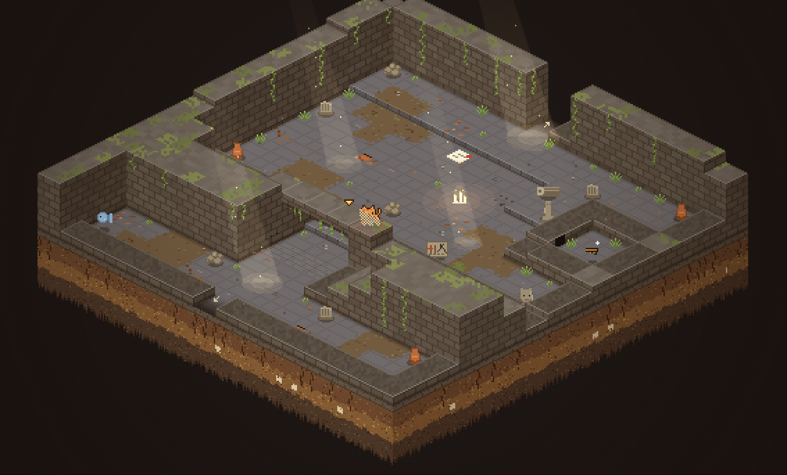
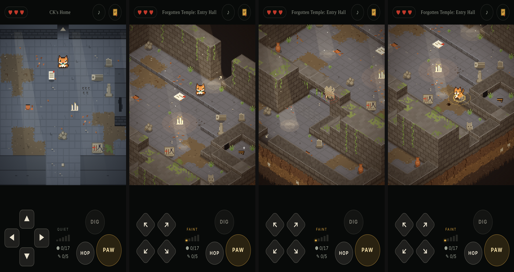

# Isometric prototype: the Entry Hall as a diorama

A reversible, flag-gated proof of concept. It redraws one room, **Forgotten
Temple: Entry Hall**, as a 2.5D isometric pixel-art diorama. Gameplay doesn't
change. The live game doesn't change either: without `?iso` in the URL, every
code path runs exactly as before.





*Phone frames, left to right: today's flat renderer (warped there with the
debug hook, hence the stale HUD title), arrival in iso, CK showing through
the gateway lintel, a dig with the collar locked on.*

## How to try it

- Local: `npm run dev`, then open `http://localhost:5173/?iso`.
- A build with the flag baked in: `VITE_ISO_PREVIEW=1 npm run build`.
- The preview starts in the Entry Hall and uses **its own save**
  (`unearth.save.isoPreview.v1`). It can't touch a player's real progress.
- Leave the hall through either exit and the game switches back to the flat
  renderer. The d-pad turns with it.

## Audit: what the game is built on

| Area | Today | What it means for iso |
|---|---|---|
| Renderer | Hand-rolled Canvas 2D, React shell, no engine, no image assets. Sprites are text rows baked once to offscreen canvases. | No engine to fight. An iso renderer is just another draw function. |
| Rooms | ASCII grids (`content/maps.ts`) plus a props layer and entity lists, built by `mapBuilder`. | Elevation fits as one more text layer in the same style. |
| Game state | Pure reducer (`game/engine.ts`) on a 4-way grid. Collision, digging, traps, hops and the collar are all grid logic, with no pixels involved. | **Nothing in game logic needs to change.** Iso is a projection of the same grid. |
| Terrain art | `tiles.ts` draws each region's floors, soft earth, trigger bricks, holes and scatter top-down. | Reused: resampled onto iso diamonds pixel by pixel. |
| Camera | Follows CK with a facing lead, clamped to the room. | Same idea, now in iso space. |
| Effects | `fx.ts` holds particles, darts, digs, held items, banners and the iris in top-down world pixels. | Read through a new read-only `fxView` and projected. No effect logic was duplicated. |
| Controls | D-pad plus Dig, Hop and Paw. Context labels come from `affordance.ts`. | Grid directions become screen diagonals, so the pad rotates 45°. Labels and affordances are untouched. |

## Architecture chosen

**A parallel renderer over the unchanged game, swapped in per room.**

```
GameState (unchanged) ──► GameCanvas frame loop (unchanged timing, motion, audio, idle)
                             ├─ flat room → render/draw.ts      (as today)
                             └─ iso room  → render/iso/frame.ts (lazy chunk, ?iso only)
```

- `src/core/preview.ts`: the flag, the list of iso rooms, and `isoActive()`.
- `src/render/iso/project.ts`: 2:1 projection with 32×16 diamonds and 4 px height steps.
- `src/render/iso/rooms.ts`: per-room elevation (text rows), plus purely
  visual architecture (gate pillars, lintels).
- `src/render/iso/terrain.ts`: builds the diorama:
  - **The floor is the game's own top-down terrain, resampled.** Every room's
    tells (soft earth, the slightly-wrong trigger bricks, holes) come across
    in the same places with no new art, so the hunt stays honest.
  - **Walls cut themselves away.** A wall is only as tall as it can be
    without hiding a walkable tile behind it. Back walls rise full height.
    Walls between CK and the camera drop to a cut-through stub, like the open
    side of a dollhouse. This is automatic, with no per-room authoring, and a
    unit test enforces it.
  - **The diorama base** shows earth strata (foundation, loam, clay,
    bedrock), with roots, pebbles and the odd bone at the cut edges. It is a
    quiet nod to a game about digging.
  - Walls are baked once per room. A dig only rebakes the floor.
- `src/render/iso/ckIso.ts`: CK in three-quarter view. New front-right and
  back-right frames (stand, step, blink, ear flick) are mirrored for the
  other two diagonals. Sit, groom and nap reuse CK's existing front frames.
- `src/render/iso/frame.ts`: one depth-sorted pass over walls, props, plants,
  entities, the lintel and CK. CK shows through anything standing in front
  of it as a dithered **x-ray silhouette**. Also handled here: light shafts
  with drifting dust, candle flicker, swaying ferns, the collar as rings on
  the ground, the Paw marker, bubbles, banner and iris, all drawn in pixels.
- **Pixel clarity:** iso draws at native art resolution, and `GameCanvas`
  scales it by a whole number of device pixels. Every art pixel is the same
  size on screen, and nothing is drawn at a fractional scale.

### What changed outside the new folder (all additive)

- `GameCanvas.tsx`: lazy-loads the iso module when the flag is on, and picks
  the renderer and integer canvas scale per room.
- `TouchControls.tsx` and `global.css`: in iso rooms the d-pad rotates 45°
  and uses arrows that keep their meaning when turned.
- `fx.ts`: particles now remember their burst origin, plus the read-only `fxView`.
- `ck.ts`: exports existing frames and the palette. No behaviour change.
- `save.ts` and `game.ts`: the preview's separate save key and start room.

## Tested

| Check | Result |
|---|---|
| Unit suite (141 tests, including 5 new iso tests: single-step elevation, cutaway rule, lintels over open tiles only, CK facing and mirroring vs. projection) | Pass |
| E2E suite at iPhone size (10 tests, flat game) | Pass: the production path is unaffected |
| Playable in iso: walk, turn, trot, hop, the dart strip (click, volley, hit, knock-back), dig with collar lock to the find card, reading Dad's notes, leaving by the north exit (the Meadow comes back flat, with the normal d-pad) | Verified by driving the build in Chromium |
| Frame time, iPhone 13 viewport, **CPU throttled 4×**, walking | iso 59.4 fps (p50 16.7 ms, p95 16.8 ms); flat 60.0 fps |
| Rebake after a dig (4× throttle) | ~47 ms. Walls are cached; only the floor rebakes, under the find card |
| First entry into the room (4× throttle) | ~220 ms, behind the room-entry iris |
| Iso code size | Separate lazy chunk, 10.4 kB gzipped. Not downloaded without `?iso` |

Not yet tested: a real iPhone in Safari. Chromium with device emulation and
CPU throttling is a proxy, not a substitute.

## Tradeoffs and open questions

1. **Controls.** Iso turns the grid's four directions into the screen's
   diagonals. The rotated pad is honest and reads clearly, but it is the
   biggest feel change. A tap-to-walk or swipe layer could sit on top later.
   That deserves a playtest before deciding.
2. **Readability vs. drama.** The auto-cutaway keeps every walkable tile
   visible, which protects the hunt. The gateway pillars are the one
   deliberate exception, mitigated by the x-ray silhouette.
3. **Flat props are billboards.** Existing 16×16 props stand upright in iso.
   Most read well (urns, rubble, columns, statue). Some carved or wall-mounted
   pieces would benefit from iso-native redraws.
4. **Floor art is resampled, not redrawn.** That is a big saving and keeps the
   tells identical. Fine linework (notes, glyphs) needed small native touches.
   A full conversion would hand-polish a handful of tiles per region.
5. **Not built yet:** dark rooms (Sunstone glow and the echo), spikes,
   falling rocks, the boulder, crumbling bridges, water, NPCs in iso poses,
   and doors and levers (these currently fall back to half-scale flat art).
6. **Camera.** It is fixed, with no rotation. Rotating views would need every
   room to read from four sides. Not recommended.

## Estimate for a full conversion

> **Superseded.** The validation pass ([iso-prototype-validation.md](iso-prototype-validation.md)) re-estimates this at ≈ 35–51 days and recommends keeping the original presentation. The table below is kept for the record; it assumed ~23 rooms, and the game has 15.

Assumes the architecture above. Gameplay code untouched. Roughly 23 rooms
across 6 regions.

| Work | Estimate |
|---|---|
| Per-region wall, cap and strata materials, light and grade (6 regions) | 3–4 days |
| Elevation and architecture layers for each room, plus readability pass and screenshots | 4–6 days (≈ 2–3 rooms a day) |
| Dark rooms in iso: Sunstone light mask, echo, the Hush | 2 days |
| Remaining hazards in iso: spikes, falling rocks, boulder, crumble span, water and pits | 3 days |
| Iso-native doors, levers, blocks, NPC 3/4 poses, extra CK frames (dig, hop, hold) | 3–4 days |
| Title screen and journal map to match (optional) | 2 days |
| Real-device iOS Safari pass, perf tuning, PLAYCRAFT and PIXELCRAFT audits, fixes | 2–3 days |
| **Total** | **≈ 19–24 working days**, deliverable room by room behind the same flag |

Because it switches per room, the conversion can ship region by region and
be reverted by removing a room id from `ISO_ROOM_IDS`.

## How to remove it

Delete `src/render/iso/`, `src/core/preview.ts`,
`tests/unit/render/iso.test.ts` and `docs/iso-prototype*`, then revert the
small hunks listed above. No saved data or content format changed.
